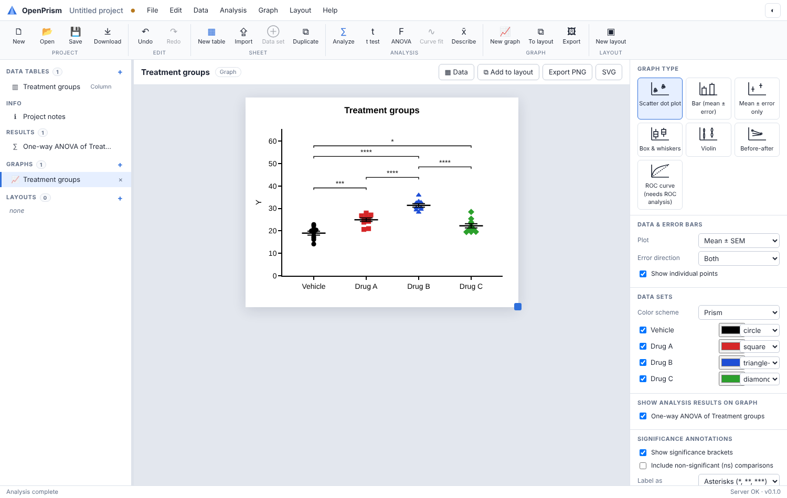
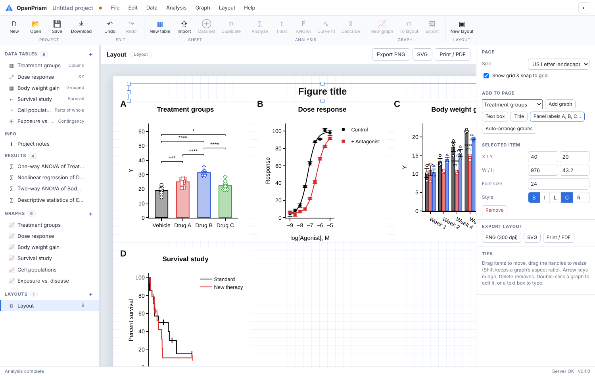

# OpenPrism — open source scientific graphing & biostatistics

OpenPrism is a free, open source workbench for the everyday work of lab scientists: enter data in
structured tables, run the right statistical test, fit curves, and produce publication-quality graphs
and multi-panel figures. It follows the familiar *data table → analysis → graph → layout* workflow.

> OpenPrism is an independent project and is not affiliated with, or endorsed by, GraphPad Software.
> See [docs/COMPARISON.md](docs/COMPARISON.md) for an honest feature comparison and [SECURITY.md](SECURITY.md) for the security design.



**Validated.** Every statistical result is checked against NIST certified reference values, R (with established CRAN
packages) and Monte-Carlo calibration: **808 of 808 checks pass** — see [docs/VALIDATION.md](docs/VALIDATION.md)
(also in the app under *Help → Validation report*). Rerun it any time with `python validation/run_validation.py`.

## Why a Flask + browser architecture?

| Option | Pros | Cons |
| --- | --- | --- |
| **Flask server + browser UI (chosen)** | SciPy/statsmodels for statistics, Plotly for vector-quality interactive graphics, runs locally *or* on a lab server for many users, nothing to install for viewers, easy to containerise | Needs a running server process |
| Desktop toolkit (Qt / Tk) | Native widgets, offline | Graphics and drag/drop canvases are a lot of work to make look good; hard to share/scale |

OpenPrism keeps the best of both: it is a web application, but drag/move/resize editing is implemented
in the browser (layout pages, resizable graphs, draggable legends and titles), and
`python run.py --desktop` opens it in a **native desktop window** via [pywebview](https://pywebview.flowrl.com/).

## Quick start

All you need is **git** and **Python 3.10+**:

```bash
git clone https://github.com/ydv-amit-ydv/public_codes.git
cd public_codes/Prism_Open_source
python3 start.py
```

The first run creates a private environment in `.venv/` and installs the packages (about a minute; nothing is
installed system-wide). Later runs start at once. Other launcher commands:

| Command | What it does |
| --- | --- |
| `python3 start.py` | start the server (installs/updates packages when needed) |
| `python3 start.py --port 8443` | any server option is passed through (`--cert/--key`, `--host`, `--data`, …) |
| `python3 start.py --reset` | **delete all server data** (accounts, projects, certificate, logs) after typing `RESET`, then start fresh |
| `python3 start.py --reset --yes --no-start` | the same without the question and without starting (scripts) |
| `python3 start.py --update --preserve` | download the latest version (`git pull`) and **keep all accounts and projects**; a backup of the database is saved in `projects/backups/` first (the 10 newest are kept) |
| `python3 start.py --update --reset` | download the latest version and **delete all accounts and projects** (asks you to type `RESET`) |

`--update` always needs `--preserve` or `--reset`, so data are never kept or deleted by accident. Stop the server
(Ctrl+C) before updating. Before a reset, tell users with an **announcement** (Admin console → Server settings →
Announcement to all users): it appears on the sign-in screen and as a banner in the app, so they can download their
projects first.

All server data live in `projects/` next to `start.py` (excluded from git), so a fresh clone always starts empty,
and deleting that folder is the same as `--reset`. The manual route also works:
`python3 -m venv .venv && .venv/bin/pip install -r requirements.txt && .venv/bin/python run.py`.

The start-up banner shows two addresses:

| | Address | Who |
| --- | --- | --- |
| **Application** | `https://<server-ip>:5000/` (all interfaces, HTTPS) | everyone in the lab |
| **Administration console** | `http://127.0.0.1:47219/` | only on the server computer |

On the **first run** the application shows *“Server setup required”*. On the server computer open the
administration console: a wizard creates the administrator, sets the registration policy (self-registration
or admin-created accounts) and default per-user limits. Users can then sign in; on later starts the
administrator already exists.

HTTPS uses an automatically generated certificate (valid for the server's name and LAN IPs) — browsers warn
once ("Advanced → Proceed"); use `--cert/--key` for your institution's certificate. HTTPS is required because
projects are **end-to-end encrypted in the browser** (WebCrypto works only on secure connections).
Open the application port in the firewall (e.g. `sudo ufw allow 5000/tcp`).

### Using it from other devices (phones, other PCs)

1. Use the `https://<server-ip>:5000/` address printed at start-up. `http://` also works: it is redirected to `https://`.
2. Accept the certificate warning once on each device (“Advanced → Proceed”).
3. If the page does not load at all, the server computer's firewall is blocking Python on this port. Typical fixes:
   * **Windows:** set the Wi-Fi network to *Private*, or in an administrator PowerShell
     `netsh advfirewall firewall add rule name="OpenPrism" dir=in action=allow protocol=TCP localport=5000`
   * **macOS:** port 5000 is used by *AirPlay Receiver* (System Settings → General → AirDrop & Handoff); turn it off
     or start with `--port 8443`, and allow Python when macOS asks.
   * **Linux:** `sudo ufw allow 5000/tcp`.
4. Guest Wi-Fi and phone hotspots often stop devices from reaching each other; use a normal network.

Options: `--port`, `--admin-port`, `--host`, `--data DIR`, `--http` (only behind an HTTPS reverse proxy),
`--cert/--key`, `--desktop`. Production: `deploy/openprism.service` (systemd, hardened) or
`docker compose up -d`. Console commands: `python run.py admin create|list|reset-admin <name>`.

Run the test-suite (statistics validated against SciPy/statsmodels; security, isolation, encryption-contract
and limit tests):

```bash
pip install pytest && python -m pytest
```

## Features

### Data tables (eight types)
| Type | Use for |
| --- | --- |
| **XY** | dose-response, time courses, standard curves — with replicate subcolumns |
| **Column** | groups to compare (t tests, one-way ANOVA) |
| **Grouped** | two grouping factors (two-way ANOVA, grouped bars) |
| **Contingency** | counts (chi-square, Fisher's exact) |
| **Survival** | time + event/censored (Kaplan-Meier) |
| **Parts of whole** | fractions (pie / donut) |
| **Nested** | groups → subjects (subcolumns) → replicate measurements (nested t test / ANOVA) |
| **Multiple variables** | one row per subject, one column per variable (multiple / logistic / Cox regression, PCA) |

Spreadsheet editor with keyboard navigation, multi-cell selection, **copy/paste to and from Excel**,
replicates, insert/delete/move rows and data sets, sort, **exclude values** (shown struck-through and
ignored by analyses), CSV/Excel import and CSV export. Projects start empty — no dummy data.

### Analyses
* **Column**: descriptive statistics (mean, SD, SEM, CI, median + CI, quartiles, CV, geometric mean/SD,
  skewness, kurtosis); normality tests (Shapiro-Wilk, D'Agostino-Pearson, Kolmogorov-Smirnov/Lilliefors,
  Anderson-Darling); one-sample t / Wilcoxon; outlier detection (Grubbs, robust ROUT-like FDR, IQR fences);
  frequency distributions; ROC curves with AUC.
* **t tests**: unpaired, Welch, paired, Mann-Whitney, Wilcoxon matched pairs — with CI of the difference,
  effect sizes, F test for variances, pairing effectiveness.
* **One-way ANOVA**: ordinary, Welch, repeated measures (Geisser-Greenhouse), Kruskal-Wallis, Friedman;
  multiple comparisons — Tukey, Dunnett, Šídák, Holm-Šídák, Bonferroni, Fisher LSD, Benjamini-Hochberg, Dunn;
  Brown-Forsythe and Bartlett tests.
* **Two-way ANOVA** (type III sums of squares, interaction) with per-row multiple comparisons; multiple t tests.
* **Nonlinear regression** with 119 built-in equations (dose-response stimulation/inhibition, 3/4-parameter,
  biphasic, Michaelis-Menten, Hill, substrate inhibition, binding, one/two-phase decay & association,
  exponential/logistic/Gompertz growth, Gaussian, lognormal, Boltzmann, power, sine, polynomials):
  parameter constraints, weighting, SE + CI, R², Sy.x, AICc, ambiguity detection, residual normality,
  **interpolation of unknowns**, **model comparison** (extra sum-of-squares F test and AICc), confidence bands,
  residual tables, EC50/IC50, half-life and doubling time.
  **User-defined equations** (safely parsed — no code execution) and **global fitting** with shared parameters
  plus an F test of whether the shared parameters differ between data sets.
* **Linear regression** (with/without origin, CI bands, runs test, comparison of slopes and intercepts),
  **correlation** (Pearson / Spearman, matrix), **area under curve**.
* **Contingency**: chi-square, Fisher's exact, odds ratio, relative risk, sensitivity/specificity, NNT,
  chi-square for trend.
* **Survival**: Kaplan-Meier with Greenwood CIs, median survival, log-rank and Gehan-Breslow-Wilcoxon tests,
  hazard ratio, pairwise comparisons.
* **Multiple variables**: multiple linear regression (VIF, diagnostics), multiple logistic regression (odds
  ratios, ROC, classification), Cox proportional hazards (hazard ratios, Harrell's C), PCA (scree with parallel
  analysis, biplot, loadings, scores table), correlation-matrix heat map.
* **Method comparison & diagnostics**: Bland-Altman (bias, limits of agreement with CIs, proportional bias),
  normal Q-Q plots, LOWESS / moving-average smoothing, derivatives and integrals.
* **Planning**: sample size & power calculator (t tests, ANOVA, two proportions, correlation) with power curves.
* **Mixed-effects models**: repeated measures with missing values, two-way repeated measures (across rows,
  data sets or both), nested t test / nested one-way ANOVA with intraclass correlation; **three-way / n-way
  ANOVA and ANCOVA**; Games-Howell, Dunnett T3, Tamhane T2, Brown-Forsythe ANOVA, two-stage FDR (BKY), Holm.
* **More regression**: **119 built-in curve-fit equations** in 15 groups (dose-response incl. 5PL and bell-shaped,
  receptor binding — homologous/heterologous competition, kinetics, Kd from association/dissociation —, enzyme
  kinetics and inhibition modes, growth models, pharmacokinetics, Weibull, Richards, Gaussian/Lorentzian peaks,
  polynomials, segmental linear…), each tested to recover its own parameters; **profile-likelihood confidence
  intervals** for every parameter (asymmetric, with unbounded limits detected); **ROUT** robust fitting/outlier removal, **Deming** and
  **Passing-Bablok** method-comparison regression, **Poisson** regression.
* **Beyond the usual commercial packages**: equivalence testing (TOST), Bayesian t test (JZS Bayes factor;
  BF10 and Hedges' g with CI also in every t test), bootstrap CIs, exact permutation tests, sample-size/power
  calculator, end-to-end encryption, multi-user server, scripting API.
* **New in 0.6 — 30 more analyses (68 in total)**: compare variances (F, Levene, Brown-Forsythe, Bartlett, Fligner-Killeen,
  Ansari-Bradley, Mood) and whole distributions (Kolmogorov-Smirnov, Cramér-von Mises, Anderson-Darling k-sample, Epps-Singleton,
  Brunner-Munzel, Mood's median); robust trimmed-means tests (Yuen, Wilcox); trend tests (linear trend, Jonckheere-Terpstra,
  Page's L); nonparametric post hoc tests (Dunn, Conover-Iman, DSCF) and repeated-measures tests (Friedman, Quade, Cochran's Q,
  Nemenyi); effect sizes with exact CIs (d, g, Glass's Δ, Cliff's δ, η², ω², ε²); sign test, SD test, percentile CIs, tolerance and
  prediction intervals; runs/Ljung-Box/von Neumann/ADF/KPSS; **circular statistics** (Rayleigh, V test, Watson-Williams);
  **reliability** (all six ICCs, Cronbach's α, Lin's CCC, Kendall's W, Fleiss' κ); P-value adjustment (Holm, Hochberg, Hommel,
  BH, BY, BKY, Storey q); **aligned-rank-transform** nonparametric two-way ANOVA; **exact polynomial regression**; robust and
  quantile regression (Theil-Sen, Siegel, Huber, bisquare, LAD); Mann-Kendall + Sen's slope; **cosinor** rhythm analysis;
  more contingency tests (G, Barnard, Boschloo, McNemar, Fisher-Freeman-Halton, Bowker, Stuart-Maxwell, Cochran-Armitage);
  risk measures with Newcombe CIs and NNT; diagnostic accuracy with likelihood ratios; Cohen's (weighted) κ; proportions with five
  CI methods; **Cochran-Mantel-Haenszel**; weighted log-rank tests (Tarone-Ware, Peto-Peto, Fleming-Harrington), **RMST**,
  survival quantiles, Nelson-Aalen; **generalized linear models** (binomial, Poisson, negative binomial, gamma, inverse Gaussian),
  **ordinal regression**, **regression diagnostics**, **MANOVA**/Hotelling's T², partial correlation, **cluster analysis**, and
  **meta-analysis** (REML/DL/PM, Hartung-Knapp, I², prediction interval, Egger/Begg, forest and funnel plots). Normality adds
  Jarque-Bera and Shapiro-Francia; outliers add generalized ESD and Hampel; correlation adds Kendall τ-b.
* **Numerically careful**: exact conditional P values for Mann-Whitney and Wilcoxon even with ties; data with a large constant
  part centred in exact decimal arithmetic; ill-conditioned regressions solved from the exact decimal data in 80-digit arithmetic;
  a multi-strategy curve fitter that converges on every NIST nonlinear problem; **All digits** mode; a 🔁 reproducibility line
  (software versions + data fingerprint) under every result; a **📝 Methods** paragraph for papers.
* **New in 0.7**: **linear mixed-effects models with random slopes** (any numeric/categorical fixed effects, GLS standard
  errors as nlme/lme4/SAS, likelihood-ratio test of the random slope; validated against `nlme::lme`), **GraphPad Prism .pzfx
  import and export**, **EPS and EMF** vector export (graphs and layouts), **shapes** on layouts (lines, arrows, rectangles,
  ellipses, brackets), a **graph style template library**, an adaptive toolbar and keyboard-navigable menus, a **calculation
  activity indicator and log**, graph summaries computed instantly in the browser, start-up preloading that makes server
  calculations up to 50× faster, and virtual scrolling for tables with thousands of rows.
* **New in 0.8**: **strict number format** (decimal point only; commas, spaces etc. are flagged, never reinterpreted),
  **Satterthwaite small-sample P values** for mixed models (validated against lmerTest), **summary-data tables** (mean, SD/SEM, n:
  t test and ANOVA with all post tests; Prism mean/SD/N files import as such), **images on layouts** (also in EPS/EMF),
  **end-to-end encrypted project sharing** between users (ECDH P-256 + AES-256-GCM, key fingerprints), **calculated columns**
  (safe formula parser), **power** for log-rank (Schoenfeld), Mann-Whitney, McNemar and one proportion, **competing-risks**
  cumulative incidence (validated against cmprsk), and **continuous integration** running all tests and the validation suite.
* **New in 0.9**: **Gray's test** comparing cumulative incidence curves and **Fine-Gray competing-risks regression**
  (subdistribution hazard ratios with the Fine-Gray robust variance; validated against `cmprsk::cuminc` and `cmprsk::crr`).
* **1.0**: fluid interaction without blocking pop-ups (instant delete with **Undo**, inline renaming, quiet
  retry when busy) and a systematic robustness sweep of every analysis on degenerate data — see
  [CHANGELOG.md](CHANGELOG.md).
* **Data processing**: transforms, normalize, remove baseline, transpose (results become new data tables).

Analyses **recalculate automatically** when their data change.

### Help, guidance & working space
* **Which test should I use?** (🧭 toolbar button): pick your goal, then click the recommended test or its alternative.
* **About this analysis** in every analysis dialog: what it does, when to use it, data layout, how to run it, how to read the
  results, assumptions, alternatives and references — the same text as the manual's analysis reference (76 cards).
* **Command palette** (Ctrl+Shift+P) to find any command or analysis by name or purpose.
* **⛶ Full screen** button (or F11) that turns into **Exit full screen**  and **focus mode** (Ctrl+Shift+F) that hides the side panels; menus and dialogs fit small windows.

### Graphs
Scatter dot plots, bars, mean ± error, box & whiskers, violins, before-after, XY points/lines/area with
fitted curves and confidence bands, grouped/stacked/percent bars, grouped scatter, heat maps,
Kaplan-Meier staircases with censor ticks, pie/donut, ROC curves — with publication styling
(L-shaped axes, outward ticks), error bars (SD, SEM, 95% CI, range, median/IQR, geometric SD),
8 colour schemes, per-data-set colours and symbols, log axes, horizontal orientation, and
**automatic significance brackets** (asterisks or P values) from t tests, ANOVA and two-way ANOVA.
Titles can be edited directly on the graph, legends dragged, and graphs resized by dragging.
**Export dialog**: TIFF (PackBits or uncompressed), PNG, JPEG, WEBP, vector PDF and SVG; size in inches, cm or
pixels; any resolution from 72 to 2400 dpi, written into the file (TIFF resolution tags, PNG pHYs, JPEG JFIF);
color or grayscale; transparent background; **export every graph to one ZIP**; or copy to the clipboard.

### Accounts, end-to-end encryption & administration
* **End-to-end encrypted projects**: every project (contents *and* name) is encrypted in the browser with the
  user's data key (AES-256-GCM). The password never leaves the browser — it is stretched (PBKDF2-SHA-256,
  600k) into a login key (the server stores only its scrypt hash) and a key-encryption key that unwraps the
  data key. The server refuses plaintext projects; neither the database nor administrators can read them.
* **Recovery key** shown at registration; after an administrator's one-time-password reset it restores
  access to existing projects (without it, nobody can decrypt them).
* **Per-user storage** with autosave (encrypted local crash-recovery copy too), conflict detection, project
  browser (open, rename, copy, download plain or password-encrypted, delete), 256 MB quota with offload
  warning at 128 MB, upload of archived plain/encrypted files.
* **Separate administration console** on a different port, reachable only from the server itself
  (loopback address + Host check): first-run setup wizard, self-registration on/off, create users with a
  one-time password, reset passwords, disable/delete accounts, per-user storage / project size / RAM / CPU /
  rate limits, default limits, administrators, password-reset requests, database backup, audit log.
  Administrator accounts are separate and cannot open user accounts or data.
* **Hardened server**: production cheroot HTTPS server, hashed session tokens in HttpOnly SameSite=Strict
  cookies, CSRF header + Origin checks, brute-force lock-out, no account enumeration, strict CSP, rotating
  access logs without bodies, OS-enforced RAM/CPU limits per calculation (forked sandbox), size/quota/rate
  limits. Details in [SECURITY.md](SECURITY.md).

### Graph customization
**Axis breaks** (Y), **second (right) Y axis**, arrows on text labels, **number-at-risk tables** under
Kaplan-Meier curves, nested scatter plots by subject.
One-click **style presets** (Classic, Journal, Slides, Minimal, Boxed, Grayscale), copy/paste format,
**apply format to all graphs**; per-axis range, tick interval, number format (decimals, %, scientific, powers of 10),
tick angle, log, reversed, gridlines, minor ticks, tick direction, axis colour/thickness; per-data-set colour, symbol,
line style and **bar hatch patterns**; bar opacity/border and **values on bars**; error-bar colour/thickness;
**reference lines** with labels; legend position presets and frame; title/axis-title sizes, font colour;
transparent background; journal/slide size presets; free text labels and fit equations on the graph.

### Help & manual
Every view, dialog option and inspector section has a **?** button that explains it on the spot and links to the
matching section of the comprehensive built-in **user manual** (Help → User manual, or F1 for the current topic).
The manual covers every table type, analysis and graph, how to choose a test, interpretation, methods and formulas,
reporting guidelines, a glossary, FAQ, deployment and the scripting API
(`openprism/static/help/manual.html`, also readable directly in a browser).

### Layouts (multi-panel figures)
Drag graphs onto a page (Letter, A4, slide), **move and resize with handles**, snap-to-grid, nudge with
arrow keys, add titles/text, add panel labels A, B, C…, auto-arrange, z-ordering, and export the whole
figure through the same export dialog (TIFF/PNG at any dpi, vector PDF and SVG). **Results tables** from any analysis
can be placed on a page; they update when the analysis re-runs and stay vector text in PDF/SVG.



### Projects
Undo/redo, autosave to the server (end-to-end encrypted), conflict detection, portable `.oprism` files
(plain JSON or password-encrypted).

## Architecture

```
Prism_Open_source/
├── run.py                    # launcher (web / desktop)
├── openprism/
│   ├── app.py                # Flask app factory, auth, security middleware, JSON API
│   ├── store.py              # SQLite: users, sessions, per-user projects, throttling, admin
│   ├── sandbox.py            # forked workers with per-user RAM/CPU limits
│   ├── stats/advanced.py     # mixed models, nested, n-way ANOVA, Deming, Passing-Bablok, Poisson, TOST, Bayes, bootstrap
│   ├── tables.py             # data-table parsing
│   ├── stats/                # statistics engine (NumPy / SciPy / statsmodels)
│   │   ├── descriptive.py    # descriptive, normality, one-sample, outliers, histograms
│   │   ├── compare.py        # t tests, one-way / RM / nonparametric / two-way ANOVA
│   │   ├── models.py         # nonlinear regression equation library
│   │   ├── regression.py     # nonlinear & linear fits, correlation, AUC, ROC
│   │   ├── survival.py       # Kaplan-Meier, log-rank
│   │   ├── contingency.py    # contingency, parts of whole, transforms
│   │   ├── multivariate.py   # multiple/logistic/Cox regression, PCA, Bland-Altman, smoothing, power
│   │   ├── custom_eq.py      # safe parser for user-defined equations
│   │   └── graphdata.py      # summaries for plotting (error bars, etc.)
│   └── static/               # single-page app (vanilla ES modules, no build step)
│       ├── js/main.js        # shell: menus, ribbon, navigator, files
│       ├── js/grid.js        # spreadsheet editor
│       ├── js/analysis.js    # analysis dialogs + result rendering
│       ├── js/graphs.js      # figure builder (Plotly)
│       ├── js/graphview.js   # graph editor/inspector
│       ├── js/layout.js      # page layout editor
│       ├── js/help.js        # on-the-spot help (? buttons)
│       ├── js/account.js     # sign-in, registration, password change, forced change
│       ├── admin.html, js/adminapp.js   # administration console (localhost port only)
│       ├── js/persist.js     # server save/autosave, project browser, encryption flows
│       ├── js/crypto.js      # WebCrypto: account keys, data key, recovery key, AES-256-GCM
│       ├── js/power.js       # sample size & power calculator
│       ├── help/manual.html  # full user manual
│       └── vendor/plotly.min.js
└── tests/                    # pytest suite
```

### API
All endpoints except health/auth require a session; state-changing requests need the header `X-OpenPrism: 1`.

| Method | Endpoint | Purpose |
| --- | --- | --- |
| POST | `/api/auth/register`, `/login`, `/logout`, `/logout-all`, `/password`, `/delete-account`, `/reset-request` | accounts |
| GET | `/api/auth/me` | current user, role and limits |
| GET/POST | `/api/projects` | list (with usage/quota) / create |
| GET/PUT/DELETE | `/api/projects/<id>` | open / save (optimistic `baseVersion`) / delete; `POST .../duplicate` |
| GET | `/api/status`, `/api/auth/kdf?username=` | setup state; key-derivation salt (fake for unknown users) |
| (admin port) | `/api/setup`, `/api/admin/...` | setup wizard, users, limits, one-time passwords, settings, backup, log |
| GET | `/api/catalog` | available analyses and curve-fit equations |
| POST | `/api/analyze` | `{analysis, table, params}` → structured results + graph overlay |
| POST | `/api/graphdata` | `{table, error}` → means / error bars for plotting |
| POST | `/api/import` | CSV / Excel upload → data table |
| POST | `/api/power` | sample size / power |

The statistics engine is a plain Python package, so it can also be used from scripts or notebooks:

```python
from openprism.tables import parse_table, make_table
from openprism.stats import run
t = parse_table(make_table("demo", "column", [{"name": "A", "reps": 1}, {"name": "B", "reps": 1}],
                           [[1.2, 2.3], [1.5, 2.9], [1.1, 2.5]]))
print(run("ttest", t, {})["sections"][0])
```

## Roadmap ideas
Random slopes in mixed models, survival curves with Cox-adjusted covariates on graphs, EMF/EPS export,
collaborative sharing of encrypted projects between users. (Freehand drawing is intentionally out of scope.)

## License
MIT — see [LICENSE](LICENSE). Plotly.js is bundled under its MIT license.
